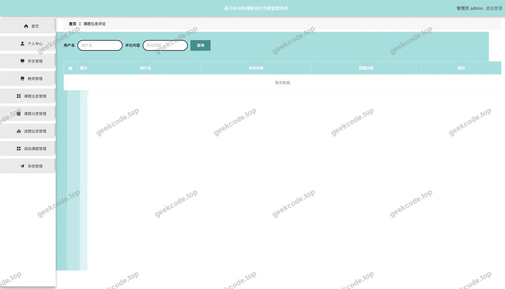
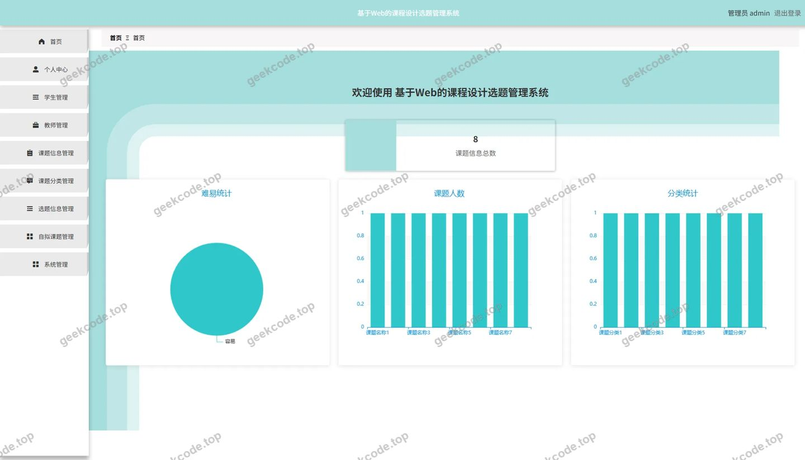
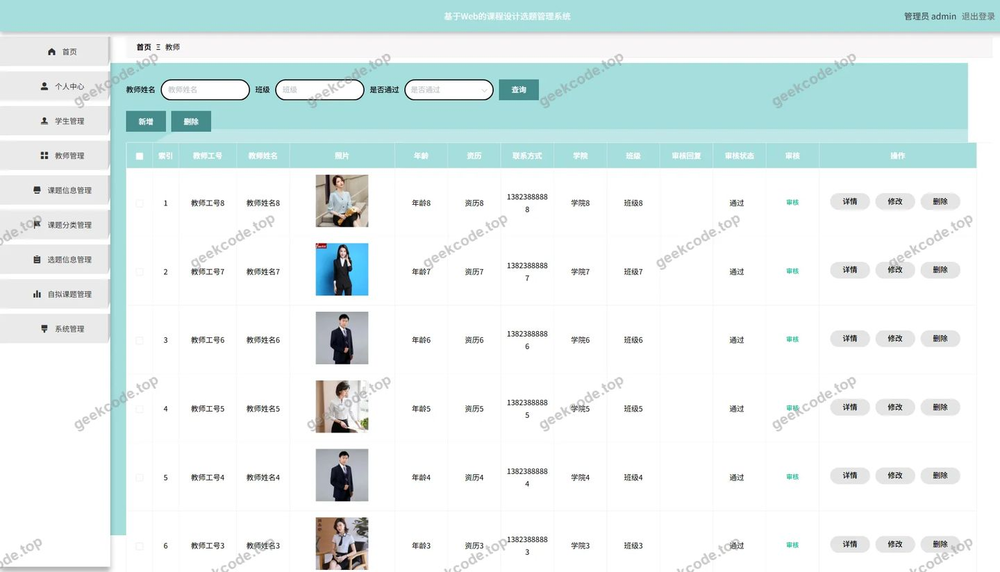
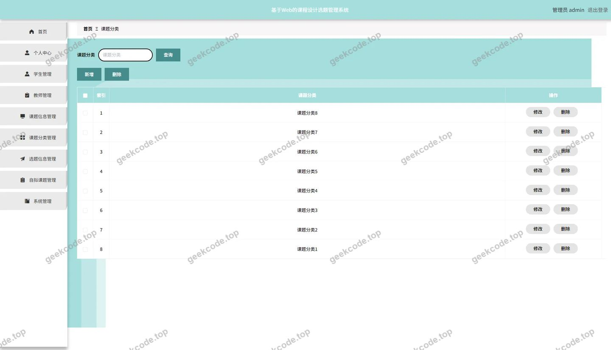
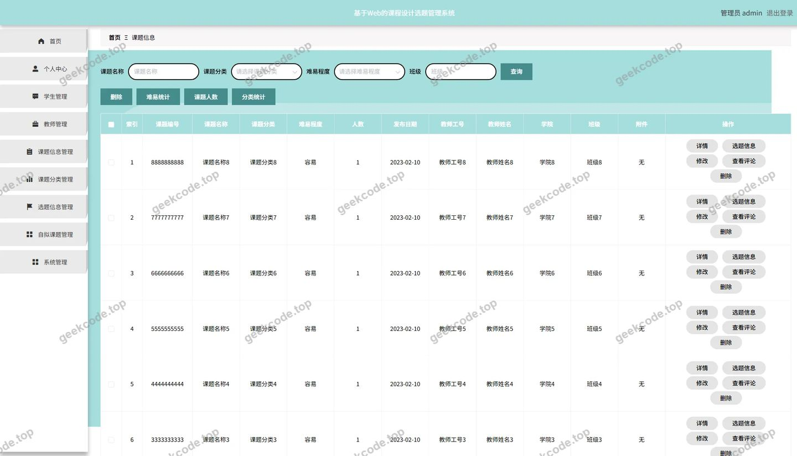
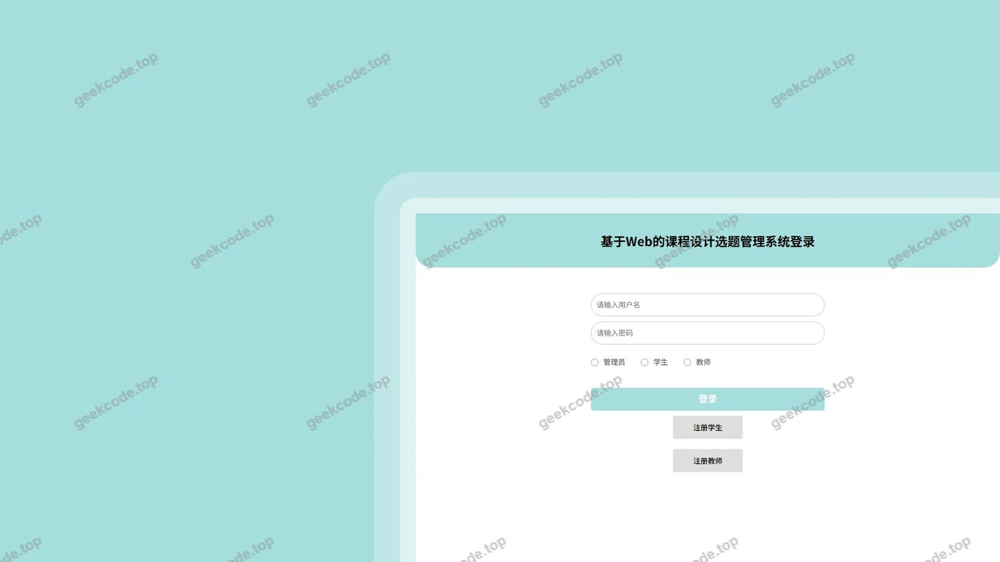
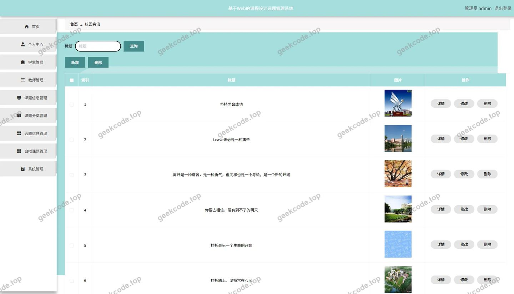
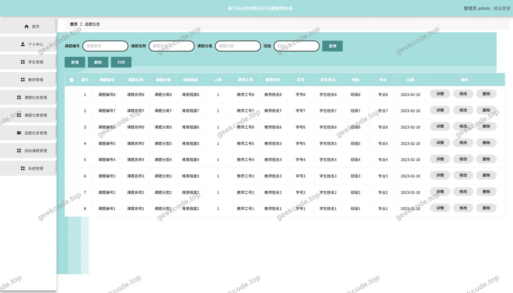
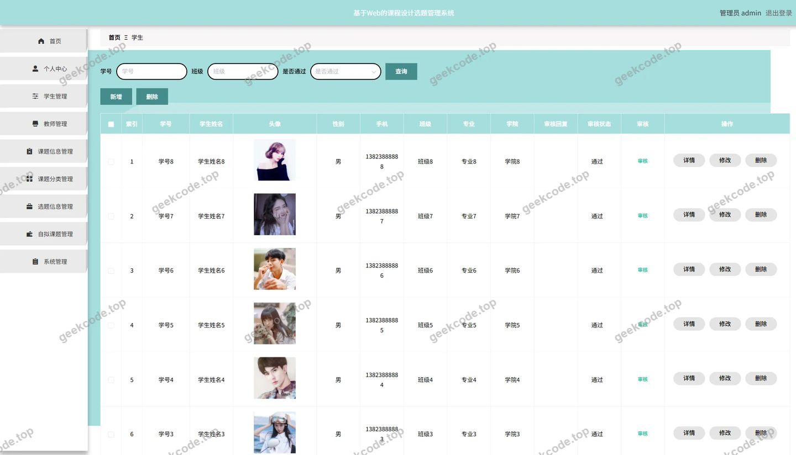
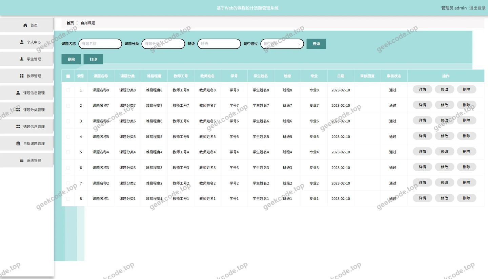

# 基于Web的课程设计选题管理系统--论文

> 🎓 **计算机毕业设计 · 基于Web的课程设计选题管理系统--论文**
>
> 本仓库只放**项目介绍 + 运行截图**（截图是站点带水印的原图，存在仓库 `images/` 里）。
>
> 👉 **完整可运行源码 / 数据库脚本 / 部署文档：[点我获取](https://geekcode.top/archives/%E5%9F%BA%E4%BA%8EWeb%E7%9A%84%E8%AF%BE%E7%A8%8B%E8%AE%BE%E8%AE%A1%E9%80%89%E9%A2%98%E7%AE%A1%E7%90%86%E7%B3%BB%E7%BB%9F-%E8%AE%BA%E6%96%87?utm_source=github)**
>
> 💬 咨询微信：**ir9372**　|　🌐 更多项目：[极客代码 geekcode.top](https://geekcode.top/?utm_source=github)
>
> 📌 项目详情页：<https://geekcode.top/archives/%E5%9F%BA%E4%BA%8EWeb%E7%9A%84%E8%AF%BE%E7%A8%8B%E8%AE%BE%E8%AE%A1%E9%80%89%E9%A2%98%E7%AE%A1%E7%90%86%E7%B3%BB%E7%BB%9F-%E8%AE%BA%E6%96%87?utm_source=github>

<table><td width="230" align="center"> <b>扫码加微信 ir9372</b></td><td valign="middle">📦 源码 = 项目介绍 + 全部运行截图 + 数据库 + 部署文档 👉 点上方任意截图，直接跳到 <b>极客代码 geekcode.top</b> 详情页</td></table>

---

<h1>基于Web的课程设计选题管理系统--论文</h1>
<h2>项目概述</h2>

本项目为“基于Web的课程设计选题管理系统”，旨在解决高校课程设计环节中选题管理分散、流程不透明及信息交互滞后等问题。系统采用前后端分离架构，后端基于 Spring Boot 框架构建，前端集成 Vue 技术栈，通过 RESTful API 实现数据交互。核心功能涵盖课题信息管理、分类维护、师生用户管理及选题申报全流程。适用人群包括系统管理员、指导教师及参与课程设计的在校学生。系统主要面向后台管理场景，提供高效的数据录入、审核与查询服务，确保选题工作的规范化与数字化，提升教学管理效率。

<h2>技术架构</h2>
<h3>后端架构</h3>

系统后端采用 Java 语言开发，基于 Spring Boot 快速构建应用框架，利用其自动配置特性简化部署流程。持久层选用 MyBatis-Plus 作为 ORM 框架，继承自 MyBatis 并提供了通用的 CRUD 操作接口，显著减少 SQL 编写工作量，同时支持复杂条件查询。安全认证模块集成 Apache Shiro，负责权限控制与会话管理，确保系统访问的安全性。数据库连接使用 MySQL Connector/J，并通过 spring-boot-starter-jdbc 进行事务管理。此外，引入 commons-lang3 工具库增强字符串处理与对象校验能力，validation-api 用于参数合法性验证。

<h3>前端架构</h3>

项目类型为 vue-integrated，表明前端逻辑与后端工程在构建阶段存在集成关系。虽然未明确独立的前台路由配置，但后台管理界面通过 Vue 组件化开发实现动态渲染。前端通过 Axios 等 HTTP 客户端向后端 Controller（如 <code>JiaoshiController</code>, <code>XueshengController</code> 等）发起请求，获取 JSON 格式数据进行页面展示与交互。

<h3>数据库设计要点</h3>

数据库基于关系型模型设计，主要实体表对应系统中的核心业务对象：

<ol>
<li><strong>用户表</strong>：存储教师（<code>jiaoshi</code>）、学生（<code>xuesheng</code>）及管理员账号信息，包含身份标识与基本属性。</li>
<li><strong>课题相关表</strong>：<ul>
<li><code>ketixinxi</code>（课题信息表）：存储课题详情、状态及所属教师。</li>
<li><code>ketifenlei</code>（课题分类表）：定义课题的类别体系。</li>
<li><code>ziniketi</code>（自拟课题表）：记录学生自主提出的课题申请。</li>
<li><code>xuantixinxi</code>（选题信息表）：关联学生与课题的最终选择结果。</li>
</ul>
</li>
<li><strong>互动与资讯表</strong>：<ul>
<li><code>discussketixinxi</code>（课题评论表）：存储用户对课题的讨论内容。</li>
<li><code>news</code>（校园资讯表）：发布系统通知或相关新闻。</li>
</ul>
</li>
<li><strong>通用配置表</strong>：<code>config</code> 存储系统基础配置参数。</li>
</ol>
<h2>功能模块</h2>

根据提供的后台路由 <code>/xuantixinxi</code>, <code>/news</code>, <code>/discussketixinxi</code>, <code>/ketixinxi</code>, <code>/xuesheng</code>, <code>/ziniketi</code>, <code>/ketifenlei</code>, <code>/jiaoshi</code> 及控制器列表，系统主要划分为以下功能模块：

<h3>1. 用户管理模块</h3>
<ul>
<li><strong>教师管理 (<code>/jiaoshi</code>)</strong>：对应 <code>JiaoshiController</code>。支持教师信息的增删改查，包括姓名、工号、联系方式等基本档案维护。</li>
<li><strong>学生管理 (<code>/xuesheng</code>)</strong>：对应 <code>XueshengController</code>。支持学生信息的录入与管理，关联班级或专业信息，便于后续选题资格校验。</li>
</ul>
<h3>2. 课题资源管理模块</h3>
<ul>
<li><strong>课题信息管理 (<code>/ketixinxi</code>)</strong>：对应 <code>KetixinxiController</code>。核心功能模块，用于发布、编辑和下架课程设计课题。包含课题名称、简介、难度等级、指导教师等字段。</li>
<li><strong>课题分类管理 (<code>/ketifenlei</code>)</strong>：对应 <code>KetifenleiController</code>。维护课题的分类字典（如“Java方向”、“算法优化”等），支持分类的新增与删除，为课题筛选提供依据。</li>
<li><strong>自拟课题管理 (<code>/ziniketi</code>)</strong>：对应隐含的业务逻辑（由 <code>StoreupController</code> 或相关Service支撑）。处理学生提交的自定义课题申请，管理员可在此查看待审核的自拟题目。</li>
</ul>
<h3>3. 选题业务模块</h3>
<ul>
<li><strong>选题信息管理 (<code>/xuantixinxi</code>)</strong>：对应 <code>XuantixinxiController</code>。记录学生成功选定课题后的最终状态。管理员可查看选题列表，监控选题进度，处理选题冲突或撤销操作。</li>
</ul>
<h3>4. 互动与资讯模块</h3>
<ul>
<li><strong>课题评论管理 (<code>/discussketixinxi</code>)</strong>：对应 <code>DiscussketixinxiController</code>。集中管理用户对课题提出的疑问或建议，支持评论内容的查看、回复或删除，促进师生交流。</li>
<li><strong>校园资讯管理 (<code>/news</code>)</strong>：对应 <code>NewsController</code>。发布系统设计相关的公告、教程或新闻，保持信息的及时传递。</li>
</ul>
<h3>5. 系统基础模块</h3>
<ul>
<li><strong>文件管理</strong>：对应 <code>FileController</code>，支持上传课题附件或图片素材。</li>
<li><strong>通用配置</strong>：对应 <code>ConfigController</code>，管理系统全局参数。</li>
</ul>
<h2>用户角色与权限</h2>

系统主要服务于后台管理场景，根据控制器命名及常规毕设逻辑，角色划分如下：

<h3>1. 系统管理员 (Admin)</h3>

拥有最高权限，负责整个系统的运维与数据监管。

<ul>
<li><strong>访问范围</strong>：所有后台路由。</li>
<li><strong>具体权限</strong>：</li>
<li><strong>用户管理</strong>：新增、编辑、删除教师和学生账号；重置密码。</li>
<li><strong>课题管理</strong>：创建、修改、删除课题信息；管理课题分类；审核学生提交的“自拟课题”。</li>
<li><strong>选题监控</strong>：查看所有学生的“选题信息”，强制调整选题结果。</li>
<li><strong>内容维护</strong>：发布和管理“校园资讯”；审核及管理“课题信息评论”。</li>
<li><strong>系统设置</strong>：配置文件上传规则及系统参数。</li>
</ul>
<h3>2. 教师 (Teacher)</h3>

<em>注：根据现有代码上下文，未发现独立的教师前台登录入口或特定权限路由描述，通常此类系统中教师可能通过管理员代为录入或通过特定链接访问，但若仅依据提供的后台路由列表，教师角色在后台主要体现为被管理的对象。若系统具备教师端功能，则其权限应限于：</em>

<ul>
<li><strong>课题发布</strong>：录入自己指导的课题信息。</li>
<li><strong>选题审核</strong>：查看选择自己课题的学生名单，确认或拒绝选题申请。</li>
<li><strong>评论回复</strong>：针对学生对自己课题的提问进行解答。</li>
</ul>
<h3>3. 学生 (Student)</h3>

<em>注：同上，若系统无独立前台，学生功能主要通过后台管理员视角下的数据呈现来推断其业务行为。若存在隐式的前台交互（如截图中的“课题信息评论”暗示有用户侧输入），学生权限应包括：</em>

<ul>
<li><strong>浏览课题</strong>：查看已发布的课题列表及分类。</li>
<li><strong>选题申报</strong>：提交“选题信息”或申请“自拟课题”。</li>
<li><strong>互动</strong>：在“课题信息”下发表评论或提问。</li>
</ul>

<em>(说明：由于项目标记为“是否有前台: 否”，且路由均为后台路径，上述教师与学生的具体操作界面未在提供的路由中直接体现为独立菜单，其业务逻辑主要依托于后台数据的录入与状态流转。)</em>

<h2>项目特色与创新点</h2>
<ol>
<li><strong>流程闭环管理</strong>：系统覆盖了从“课题分类定义” -&gt; “课题发布” -&gt; “学生浏览/评论” -&gt; “正式选题/自拟申请” -&gt; “选题结果归档”的全生命周期，实现了课程设计选题业务的数字化闭环。</li>
<li><strong>灵活的自拟机制</strong>：专门设立“自拟课题”模块，允许学生在导师指导下提出个性化选题，体现了以学习者为中心的教学理念，区别于传统的单向指派模式。</li>
<li><strong>即时互动反馈</strong>：集成“课题评论”功能，打破了传统选题过程中师生沟通壁垒，学生可在选题前对课题细节进行咨询，提高了选题的匹配度和准确性。</li>
<li><strong>轻量化技术选型</strong>：采用 Spring Boot + MyBatis-Plus + Shiro 的经典组合，在保证企业级应用安全性（Shiro）的同时，极大提升了开发效率（MyBatis-Plus），适合中小型教务管理系统的快速迭代与维护。</li>
</ol>
<h2>部署环境</h2>

为确保系统正常运行，需准备以下软硬件环境：

<h3>硬件要求</h3>
<ul>
<li><strong>CPU</strong>: Intel Core i3 及以上处理器</li>
<li><strong>内存</strong>: 4GB RAM 及以上（推荐 8GB）</li>
<li><strong>硬盘</strong>: 至少 10GB 可用空间</li>
</ul>
<h3>软件环境</h3>
<ul>
<li><strong>操作系统</strong>: Windows 7/10/11, Linux (CentOS 7+, Ubuntu 18.04+) 或 macOS</li>
<li><strong>JDK</strong>: Java Development Kit 1.8 或以上版本（推荐 JDK 1.8）</li>
<li><strong>数据库</strong>: MySQL 5.7 或 MySQL 8.0</li>
<li><strong>构建工具</strong>: Maven 3.6+</li>
<li><strong>Node.js</strong>: 12.x 或更高版本（用于前端依赖安装与打包，若为集成编译模式）</li>
<li><strong>Web服务器</strong>: 内置 Tomcat (Spring Boot Starter Web 自带)，生产环境可配合 Nginx 反向代理</li>
<li><strong>浏览器</strong>: Chrome, Firefox, Edge 等现代浏览器</li>
</ul>
<h3>关键配置项</h3>
<ul>
<li><code>application.yml</code>: 需配置 MySQL 连接地址、用户名、密码。</li>
<li><code>pom.xml</code>: 确保 <code>mysql-connector-java</code>, <code>mybatis-plus-boot-starter</code>, <code>shiro-spring</code> 等依赖版本兼容。</li>
</ul>
<h2>五、技术特性</h2>
<ul>
<li>前后端集成部署，前端资源打包至后端 static 目录</li>
<li>使用 MyBatis-Plus 简化数据访问层开发</li>
<li>集成 Shiro 权限框架实现角色权限控制</li>
</ul>
<h2>六、功能模块截图</h2>
<h3>后台管理端</h3>
<h4>后台-课题信息评论</h4>

<h4>后台首页</h4>

<h4>后台-教师</h4>

<h4>后台-课题分类</h4>

<h4>后台-课题信息</h4>

<h4>后台-登录</h4>

<h4>后台-公告信息</h4>

<h4>后台-选题信息</h4>

<h4>后台-学生</h4>

<h4>后台-自拟课题</h4>

---

## 获取完整源码

| 项目 | 说明 |
| --- | --- |
| 项目名 | 基于Web的课程设计选题管理系统--论文 |
| 运行截图 | 本文 10 张（站点带水印原图，仓库 `images/` 目录） |
| 完整源码 | [https://geekcode.top/archives/%E5%9F%BA%E4%BA%8EWeb%E7%9A%84%E8%AF%BE%E7%A8%8B%E8%AE%BE%E8%AE%A1%E9%80%89%E9%A2%98%E7%AE%A1%E7%90%86%E7%B3%BB%E7%BB%9F-%E8%AE%BA%E6%96%87?utm_source=github](https://geekcode.top/archives/%E5%9F%BA%E4%BA%8EWeb%E7%9A%84%E8%AF%BE%E7%A8%8B%E8%AE%BE%E8%AE%A1%E9%80%89%E9%A2%98%E7%AE%A1%E7%90%86%E7%B3%BB%E7%BB%9F-%E8%AE%BA%E6%96%87?utm_source=github) |
| 咨询微信 | **ir9372**（备注：jingpin-yuanma） |
| 更多项目 | [极客代码 geekcode.top](https://geekcode.top/?utm_source=github) |

> 需要源码、部署、改配置、跑不起来等问题，加微信 ir9372 沟通，说明项目名即可。
